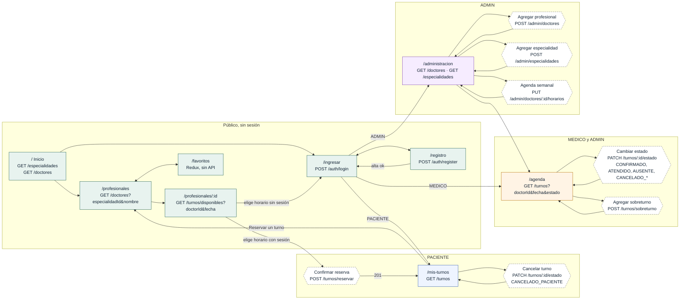

# Mockups y wireflow · Actividad 03

Este documento completa el [prototipo en Figma](https://www.figma.com/design/sG2DFO6kln0dmeYP3QUpFB/Front-turnera-medica) (12 pantallas de escritorio) con lo que faltaba para la Actividad 03:

- el mapa de navegación por rol;
- la relación de cada pantalla y acción con los endpoints reales del backend;
- las pantallas de ingreso y registro;
- las versiones móviles;
- los estados de carga, vacío, error y confirmación.

Las capturas de `docs/mockups/` salen de la aplicación real en modo demo local (`VITE_DATA_MODE=static`), en escritorio (1366 px) y en móvil (iPhone 13). El diagrama también está exportado en [`wireflow.svg`](wireflow.svg) y [`wireflow.png`](wireflow.png) para incluirlo en el ZIP de entrega.

## Mapa de navegación por rol

Todos los endpoints llevan el prefijo `/api`. Las rutas protegidas redirigen a `/ingresar` si no hay sesión. Si la sesión pertenece a otro rol, muestran "Este espacio pertenece a otro perfil". Un 401 cierra la sesión y vuelve al ingreso.

## Pantallas, roles y endpoints

| Pantalla | Ruta | Rol | Operaciones del backend | Figma | Escritorio | Móvil |
| --- | --- | --- | --- | --- | --- | --- |
| Inicio | `/` | Público | `GET /especialidades`, `GET /doctores` | Turnera · Desktop | [ver](mockups/01-inicio-escritorio.jpg) | [ver](mockups/01-inicio-movil.jpg) |
| Ingreso | `/ingresar` | Público | `POST /auth/login` | No está | [ver](mockups/02-ingresar-escritorio.jpg) | [ver](mockups/02-ingresar-movil.jpg) |
| Registro de paciente | `/registro` | Público | `POST /auth/register` | No está | [ver](mockups/03-registro-escritorio.jpg) | [ver](mockups/03-registro-movil.jpg) |
| Directorio de profesionales | `/profesionales` | Público | `GET /doctores?especialidadId&nombre`, `GET /especialidades` | Directorio desktop | [ver](mockups/04-profesionales-escritorio.jpg) | [ver](mockups/04-profesionales-movil.jpg) |
| Perfil y disponibilidad | `/profesionales/:id` | Público, reserva con PACIENTE | `GET /turnos/disponibles?doctorId&fecha`, `POST /turnos/reservar` | Perfil y disponibilidad + Confirmar turno | [ver](mockups/05-profesional-disponibilidad-escritorio.jpg) | [ver](mockups/05-profesional-disponibilidad-movil.jpg) |
| Mis turnos | `/mis-turnos` | PACIENTE | `GET /turnos`, `PATCH /turnos/:id/estado` (cancelar) | Mis turnos + Modal cancelar | [ver](mockups/06-mis-turnos-escritorio.jpg) | [ver](mockups/06-mis-turnos-movil.jpg) |
| Agenda profesional | `/agenda` | MEDICO, ADMIN | `GET /turnos`, `PATCH /turnos/:id/estado`, `POST /turnos/sobreturno` | Agenda médica + Modal | [ver](mockups/07-agenda-profesional-escritorio.jpg) | [ver](mockups/07-agenda-profesional-movil.jpg) |
| Administración | `/administracion` | ADMIN | `POST /admin/doctores`, `POST /admin/especialidades`, `PUT /admin/doctores/:id/horarios` | Administración (profesionales, especialidades, agenda, modal) | [ver](mockups/08-administracion-escritorio.jpg) | [ver](mockups/08-administracion-movil.jpg) |
| Favoritos | `/favoritos` | Público | Ninguna: estado en Redux Toolkit | No está | — | — |

### Transiciones de estado desde el front

| Rol | Desde RESERVADO | Desde CONFIRMADO |
| --- | --- | --- |
| PACIENTE | CANCELADO_PACIENTE | CANCELADO_PACIENTE |
| MEDICO | CONFIRMADO, CANCELADO_MEDICO | ATENDIDO, AUSENTE, CANCELADO_MEDICO |
| ADMIN | CONFIRMADO, CANCELADO_MEDICO, CANCELADO_PACIENTE | ATENDIDO, AUSENTE, CANCELADO_MEDICO, CANCELADO_PACIENTE |

AUSENTE y las cancelaciones piden un motivo. El backend además aplica las reglas temporales: solo se confirma o se cancela antes del inicio, y solo se marca ATENDIDO o AUSENTE cuando el turno terminó. Si no se cumplen, el front muestra el mensaje del 409 que devuelve la API.

### Rutas alternativas sin pantalla propia

Estas rutas existen en el backend, pero no tienen pantalla duplicada:

- `POST /pacientes`: es un alta de paciente equivalente a `POST /auth/register`. El front usa `/auth/register`.
- `POST /doctores` y `POST /especialidades`: son altas equivalentes a las de `/admin/...`. El front usa las de administración, protegidas para ADMIN.

## Estados de la interfaz

| Estado | Cómo se ve | Captura |
| --- | --- | --- |
| Carga | Indicador "Cargando información…" mientras llega la respuesta | [estado-carga](mockups/estado-carga-escritorio.jpg) |
| Vacío | Mensaje con sugerencia, por ejemplo "No encontramos profesionales" | [estado-vacio](mockups/estado-vacio-escritorio.jpg) |
| Error de recurso | Aviso de que no se pudo cargar, con botón "Volver a intentar" | [estado-error](mockups/estado-error-escritorio.jpg) |
| Error de formulario | Campos marcados con el mensaje de validación de cada uno | [estado-error-formulario](mockups/estado-error-formulario-escritorio.jpg) |
| Confirmación | Aviso de éxito al volver a "Mis turnos" después de reservar | [estado-confirmacion](mockups/estado-confirmacion-escritorio.jpg) |

## Diferencias entre el Figma y la implementación

- **Ingreso y registro:** no tienen pantallas en el Figma. Las de la aplicación siguen el mismo estilo de tarjeta dividida y quedan documentadas con las capturas de arriba.
- **Móvil:** el Figma es solo de escritorio. La versión móvil es responsive: menú hamburguesa, tarjetas en una columna y formularios a ancho completo. Se verificó con las capturas en iPhone 13.
- **Favoritos:** la pantalla se agregó en la UVA 5 con Redux Toolkit y no figura en el Figma.
- **Confirmar turno:** en el Figma es un modal sobre el perfil. En la aplicación es el mismo modal con el resumen del turno y el botón "Confirmar reserva".
- **Fuente de datos:** el pie de página de la aplicación permite alternar entre la demo local y la API real. Es una herramienta de desarrollo y no forma parte del diseño.
